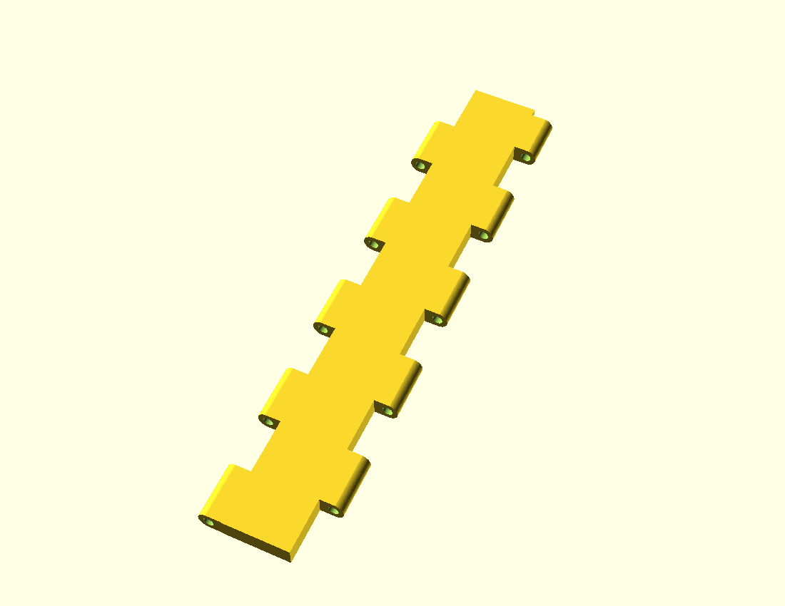

# Cửa xếp — SCAD V4.2 FINAL

Cấu trúc thư mục và vai trò dữ liệu: [docs/STRUCTURE.md](docs/STRUCTURE.md).

**Bản final cập nhật ngày 2026-10-23:** mở [accordion.scad](accordion.scad) tại gốc dự án; thư viện ren đi cùng là [threads.scad](threads.scad). [Hồ sơ chốt bản final và hash nguồn](FINAL.md). Các bản lưu lịch sử chỉ được publish sau privacy scan; thư mục `archive/` không thuộc bộ hiện hành.

Mỗi leaf là một solid duy nhất, gồm tấm che và tai bản lề liền nhau. Không còn vỏ A/B, thanh khóa hoặc chốt chặn đầu khóa. Các leaf nối với nhau bằng chốt bản lề tháo được.

Đổi **`W=620`** trong `accordion.scad` để chọn bề rộng cụm (430–1.000 mm, chấp nhận cả số lẻ/thập phân). Số leaf tự tính thành số chẵn: `2*ceil((W-20)/(2*(pitch-2)))`. Tại W=620 cần **16 leaf và 17 chốt**; tại W=430–500 cần 12 leaf và 13 chốt. Mỗi leaf rộng ngoài 51,2 mm, cao 250 mm. Tấm và phần nối dày **9 mm**, bằng chiều cao ống bản lề, in nằm với lỗ tròn **Ø4,6 mm**.

- Thanh ren đực TR20×4 liền gá trái tự tính trong khoảng 175–240 mm: tại W=620 dài 175 mm, bao in gá trái 185 × 250 mm. Ren nằm ngang, cắt phẳng phía dưới và có sống nhỏ liền lõi để đặt bàn.
- Đoạn nối tự tính dài 160–230 mm sau lắp, mỗi đoạn gồm **hai chi tiết in riêng**: thân socket kín Ø32 và trục ren đực; cả hai in nằm ngang với mặt cắt đáy riêng. Trục vặn vào thân 20 mm, có vai chặn dày 3 mm; đầu làm việc dài 110 mm. Miệng trước của socket sâu 25 mm. Tại W=620 in 2 bộ, mỗi bộ dài 187,5 mm sau lắp; W=1.000 in 4 bộ, mỗi bộ 201,25 mm.
- Gá trái giữ chân loe cục bộ; cả hai gá có sống dọc dài 250 mm nối phần ren tới dãy tai chốt.
- Ống cái và gá phải in cùng một lần, khớp xoay print-in-place. Khe hướng kính danh nghĩa 0,6 mm. Vòng gá kín, thành đáy 2,2 mm. Thân ống cái dùng chung `thread_socket_outer_r=16` (Ø32) với socket CT09; chân liền rộng 9 mm chạm bàn, hai sườn dưới vát 45°. Đoạn chuyển tiếp 4 mm nối tới khớp V. Vành giữ Ø36, eo Ø21, ren trong 118 mm và tổng dài 139,5 mm giữ nguyên. Khớp giữ dịch vào trong để vành cuối không vượt mặt ép phải. Cùng Ø32 nhưng hai socket có chiều dài và cấu tạo chân khác nhau theo cơ cấu lắp.
- Hai gá có sống dạng hình thang cân ở phần dưới, hai cạnh vát 45°: chiều cao vát trái 23,7 mm / phải 33 mm; đáy còn 202,6 / 184 mm, mép trên giữ 250 mm. Chừa 0,3 mm dưới chân tai thấp nhất; tai và lỗ chốt tròn giữ nguyên. Assembly dùng chính các solid đã cắt đáy để in.
- Hai sống dùng chung `support_web_width=10` mm và đối xứng qua trục bản lề, cùng mốc kết thúc vát dưới tai. Gá trái giữ chân ren liền; gá phải giữ vòng PIP và phần đỡ phủ hết mặt dưới thành. Hai mặt đáy vẫn lệch 9,3 mm để cơ cấu ren nằm đúng trên bàn; đây không phải hai gá bằng tổng chiều cao.
- Khoét vòng PIP xuyên hết sống phải theo cùng tham số `support_web_width`; vòng giữ vẫn kín, lỗ xoay vẫn tròn. Không thu sống xuống dưới10 mm vì sẽ thiếu phần đỡ thành gá phải. Chưa đo độ bền thực tế.
- Không ray và không phụ kiện kim loại.



## File chính

- [Tóm tắt kiểm chứng và giới hạn](docs/VALIDATION.md).

- [Gá phải + female rotor — 3MF để in chung](exports/parts/right-pip.3mf): một đối tượng gồm hai phần, giữ khe PIP và hai mặt cắt đáy tại Z=0. Dùng nguyên cụm này khi in; tư thế rotor trong Assembly có pha xoay khác tư thế in.

- [Assembly V4.2 — 3MF có 40 đối tượng riêng](exports/accordion.3mf), [STL có 40 khối kín](exports/accordion.stl): xuất từng chi tiết ở đúng vị trí lắp, giữ riêng socket và trục CT09. Bằng chứng đo và giới hạn được tóm tắt trong [validation summary](docs/VALIDATION.md).

- [Leaf liền khối — STL](exports/parts/leaf.stl), [3MF](exports/leaf.3mf): 51,2 × 250 × 9 mm; một solid, mặt đáy tại Z=0.
- [Chốt bản lề — STL](exports/parts/hinge-pin.stl): đặt nằm, có mặt D; bao 250 × 8 × 5,5 mm.
- [Gá trái + ren đực — STL](exports/parts/left-support.stl), [bộ gá phải + ống cái — STL](exports/parts/right-pip.stl). [Gá phải riêng](exports/parts/right-support.stl) là hình học tham chiếu.
- CT09: [socket kín](exports/parts/rod-socket.stl) và [trục ren đực](exports/parts/rod-shaft.stl), hoặc [cả bộ hai chi tiết](exports/parts/rod-extension.stl). Tại W=620, in 2 socket + 2 trục, hoặc in file cả bộ hai lần; không in trùng hai cách.
- [Bộ thử lắp 50 mm](exports/fit-kit.stl): hai leaf ngắn và một chốt chung.
- [Danh mục CT01–CT08](docs/CHI-TIET.md).
- [Ba leaf đã nối](exports/three-leaves.png), [toàn cụm](exports/assembly.png), [STL toàn cụm để xem](exports/accordion.stl), [mặt cắt lỗ](exports/leaf-section.png).
- [Source OpenSCAD](accordion.scad), [ren TR20×4](threads.scad), [tóm tắt mesh/slicer đã khử path máy](docs/VALIDATION.md).
- [Script Fusion — baseline V4.2 cố định](fusion/README.md). Bộ input trước thay đổi female32 được bàn giao riêng cùng source/hash và evidence W620. Đồng bộ native với SCAD final ở gốc giữ trạng thái `not_run`.
- [Mockup tư thế gập](mockup/index.html), [cách chạy](mockup/README.md).
- Checkpoint và log chạy local không thuộc public snapshot; xem [cấu trúc dữ liệu](docs/STRUCTURE.md).
- Bản lưu V1–V4 chỉ được đưa vào snapshot sau privacy scan riêng.

STL toàn cụm là tư thế lắp để xem. Khi in dùng STL riêng hoặc bộ thử lắp. File 3MF không kèm profile máy in.

`W` chọn cấu hình để xuất/in, không phải cam kết một bộ đã in điều chỉnh được toàn dải 430–1.000 mm. Source tự tính số leaf chẵn, số chốt, số đoạn nối và chiều dài chi tiết để vừa bàn. Xuất lại chi tiết thay đổi và in đúng số lượng console báo. Chỉ số lá cần chẵn; W không cần làm tròn sang số chẵn. Lá và chốt dài đúng 250 mm; cần kiểm tra vùng in thực và chỗ brim/skirt trong slicer.

### Đoạn nối CT09 và chuyển động trên cùng bộ in

Toàn bộ ren đực của gá trái, trục CT09 và mẫu thử có lỗ dọc tim xuyên suốt **Ø2 mm**, kể cả phần chân/vai. Tham số `male_bore_d=2` đặt cạnh `thread_offset` trong source chính. Hai guard giữ thành quanh lõi ren và dưới mặt cắt phẳng >2 mm. Lỗ để rỗng theo yêu cầu, chưa có bằng chứng nó tăng độ bền.

`part="print-rod-extension"` đặt cả socket và trục rời lên bàn. `print-rod-socket`/`print-rod-shaft` xuất riêng từng chi tiết; `rod-extension` xem chúng sau lắp. Socket có lỗ tròn thông suốt, giữ kín toàn bộ vòng ngoài; mặt cắt cách tâm 12,5 mm để còn ít nhất 2 mm thành dưới rãnh ren. Mặt cắt trục cách tâm 7 mm, đi vào lõi ren khoảng 0,394 mm để chân ren chạm bàn trực tiếp, không thêm sống đỡ. Chuẩn ren và `thread_offset` giữ nguyên.

Vặn trục vào đầu sau socket đến khi vai trục tì mặt thân. Đây là mối nối nhựa có ren; chưa xác minh mô-men siết, tự tháo hoặc độ bền sau in. Assembly dựng ở tư thế vai đã tì, nên Boolean có thể nối hai mesh thành một tại mặt tiếp xúc; số chi tiết in thực vẫn là hai cho mỗi CT09.

Giữ `W=620`, đổi `clamp_travel=0..75` để xem cùng bộ in siết từ 620 xuống 545 mm. Số leaf, pin và kích thước các phần in không đổi; vị trí gá phải, góc gập lá và pha xoay female thay đổi theo hành trình. Đây là các tư thế hình học, chưa phải kiểm chứng lực hoặc chuyển động thực tế.

## Cấu tạo và hướng in

Tấm che và phần nối tai đều dày **9 mm**. Trong mô hình lắp, mặt đáy Z=-4,5 và mặt trên Z=+4,5; khi in, mặt dưới cùng ở Z=0. Giữ bước trục 42 mm, bề rộng ngoài 51,2 mm, tai dài 24,7 mm trên nhịp 25 mm và lỗ tròn Ø4,6 mm.

Phần nối từ tấm tới mỗi ống là khối chữ nhật **6 × 24,7 × 9 mm**, hai vai vuông 90°.

Thành quanh lỗ chốt yêu cầu tối thiểu **2 mm**. Tai lá dùng biên tròn Ø9,2 mm, cắt phẳng ở Z=±4,5; thành mỏng nhất danh nghĩa **2,2 mm**. Tai hai gá có biên đa giác liền chân nối, vát góc trên để tránh cấn leaf; thành nhỏ nhất đo trên STL khoảng **2,084 mm**. Lỗ Ø4,6, chốt, bước trục và khe dọc các tai được giữ.

Lỗ nằm ngang khi in. Phần cung tròn phía trên cần các lớp bắc cầu ngắn. Một leaf cao 250 mm in một chi tiết. Cụm mặc định W=620 dùng 16 leaf, 17 chốt, hai gá, ống ren cái và hai đoạn nối dài 187,5 mm. Console OpenSCAD in số leaf/chốt, chiều dài ren trái và số lượng/chiều dài đoạn nối tương ứng với W. Với W=1.000 cần 26 leaf, 27 chốt và 4 đoạn nối giống nhau.

## Gia cường chân gá

- Sống dọc cả hai gá chạy đủ 250 mm tới mặt bàn in. Gá trái giữ chân loe rộng 64 mm tại chân ren.
- Tai gá được đùn từ một polygon gồm mắt chốt và chân nối. Góc ngoài vát để tránh giao với leaf ở tư thế gập; lỗ Ø4,6 giữ tròn.
- Vòng phải kín R20, thành đáy 2,2 mm. Khoang V được trừ sau khi hợp nhất vòng và sống gá; khe quay hướng kính 0,6 mm.
- Trục ren và hai mặt ép ngoài được giữ. Cụm giữ rotor dịch vào trong 7 mm để vành cuối không nhô quá mặt ép.

Chưa có số đo tải vít hoặc mô-men siết sau in.

## Kiểm chứng offline

Báo cáo gắn với SHA-256 của source/STL, PrusaSlicer 2.9.6, nozzle 0,4 mm, lớp 0,2 mm, infill 100%:

- Leaf là một mesh kín, bao 51,2 × 250 × 9 mm. Bộ thử lắp có ba solid.
- Support tự động 45° đề xuất khoảng **2 607 mm³** nhựa support cho leaf đủ dài.
- Khi tắt support, đường đùn bridge dài nhất khoảng **5,161 mm** ở Z=7,0 mm, kể cả phần neo. Đây là một đoạn chạy đầu in, không phải số đo võng.
- Quy trình kiểm giao tại 16 cấu hình từ W=430 đến 1.000 mm, gồm số lẻ/thập phân và hai phía các ngưỡng đổi số đoạn nối. Trên cùng bộ W=620, kiểm 17 tư thế siết 0–75 mm; có đối chứng sai pha ren và ép quá vai CT09.
- PIP được kiểm 72 góc cách nhau 5° tại W=620 và tám góc tại W=430 / 550 / 1.000. Các phép kéo ±1,2 mm kiểm chặn tuột hình học.

Các file in được đo khổ và chạy slicer tắt support, kiểm tọa độ đùn trong bàn 250 × 250 mm. Cặp phải cuối còn cảnh báo `Collapsing overhang` và `Low bed adhesion`; đối chứng ghi nhận cảnh báo overhang theo việc mở lỗ PIP, không theo hai cạnh vát45°. Không coi xuất G-code thành công là chứng nhận in không support thực tế. Xem [tóm tắt kiểm chứng bản hiện hành](docs/VALIDATION.md).

**Chưa in thật:** độ vừa của chốt, mái lỗ, cong vênh, độ vừa và tự tháo của mối ren CT09 mới, lực, mỏi, độ bền và độ kín cửa. Các giới hạn này được ghi rõ trong [validation summary](docs/VALIDATION.md); audit log chi tiết vẫn local.

V1–V4 là lịch sử local, không phải bộ in hiện hành; BOM in lấy từ các file được liên kết ở trên.

## Dựng lại

Chạy từ thư mục project, bằng Python có NumPy:

```powershell
python build.py
```

Script xuất STL/3MF/ảnh, kiểm tra solid và va chạm, lưu cả cắt lớp bật support và tắt support. Có thể truyền `--openscad` và `--slicer`, hoặc đặt `OPENSCAD_EXECUTABLE`/`PRUSASLICER_EXECUTABLE`. G-code chẩn đoán và log slicer nằm trong thư mục local `verification/`, không thuộc public snapshot. Script không nối máy in.

Sau build, xuất Assembly đủ40 chi tiết vật lý và3MF cặp phải giữ hai named volume ở tư thế in:

```powershell
Các script xuất separated/print là checkpoint local và không thuộc public
snapshot; các artifact hiện hành đã được liệt kê trong `exports/` ở trên.
```

Kiểm file giao theo [validation summary](docs/VALIDATION.md); hash/báo cáo cũ chỉ có hiệu lực với đúng revision đã chạy.

Kiểm tra nhanh quy tắc kích thước bằng `python tests/test_dimensions.py`; kiểm thành lỗ bằng `python tests/test_hinge_wall.py`. Kiểm tra này gọi OpenSCAD thật theo đường dẫn portable trên máy, gồm số lá chẵn, hai đầu cùng cao độ, số đoạn nối/chiều dài/pha ren ở các ngưỡng, khổ in và từ chối W ngoài giới hạn.

Bản leaf tách vỏ cũ và các thử nghiệm trung gian nằm trong working copy local; chúng không thuộc bộ in hiện hành.
