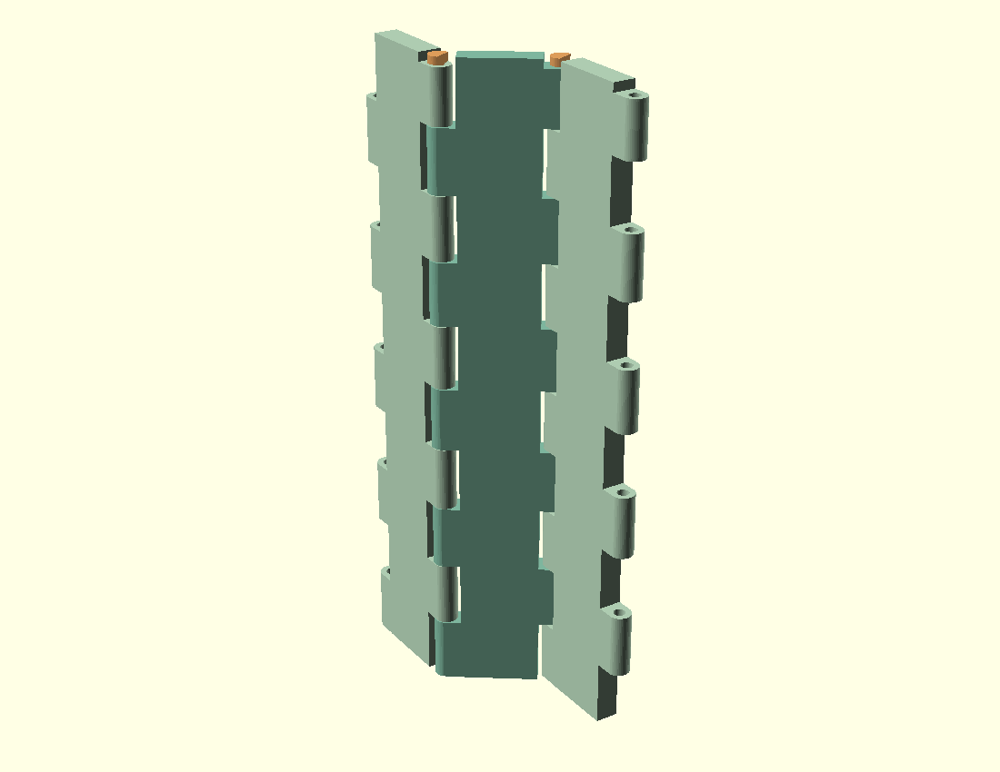
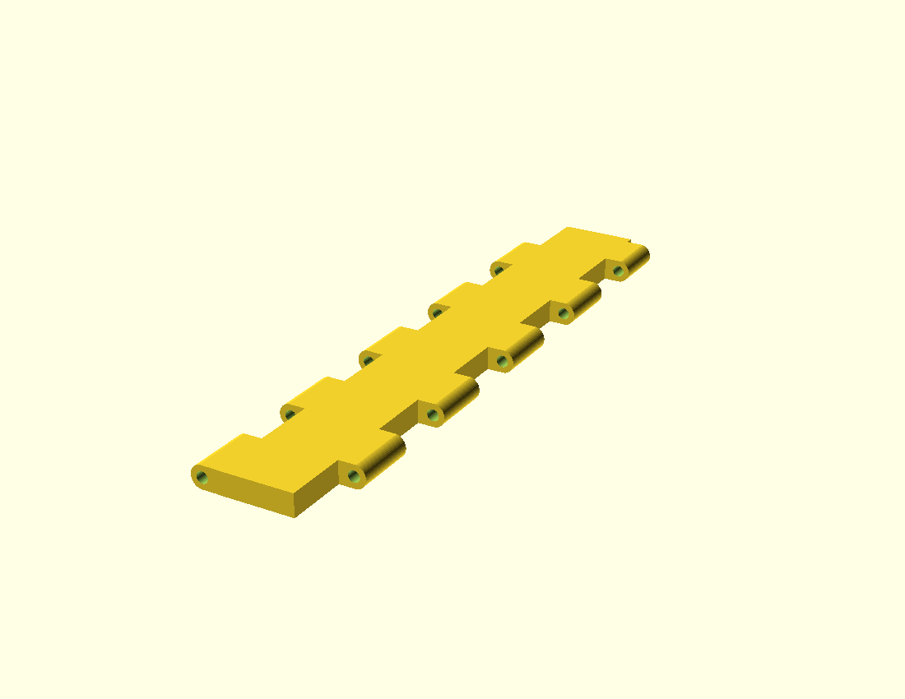
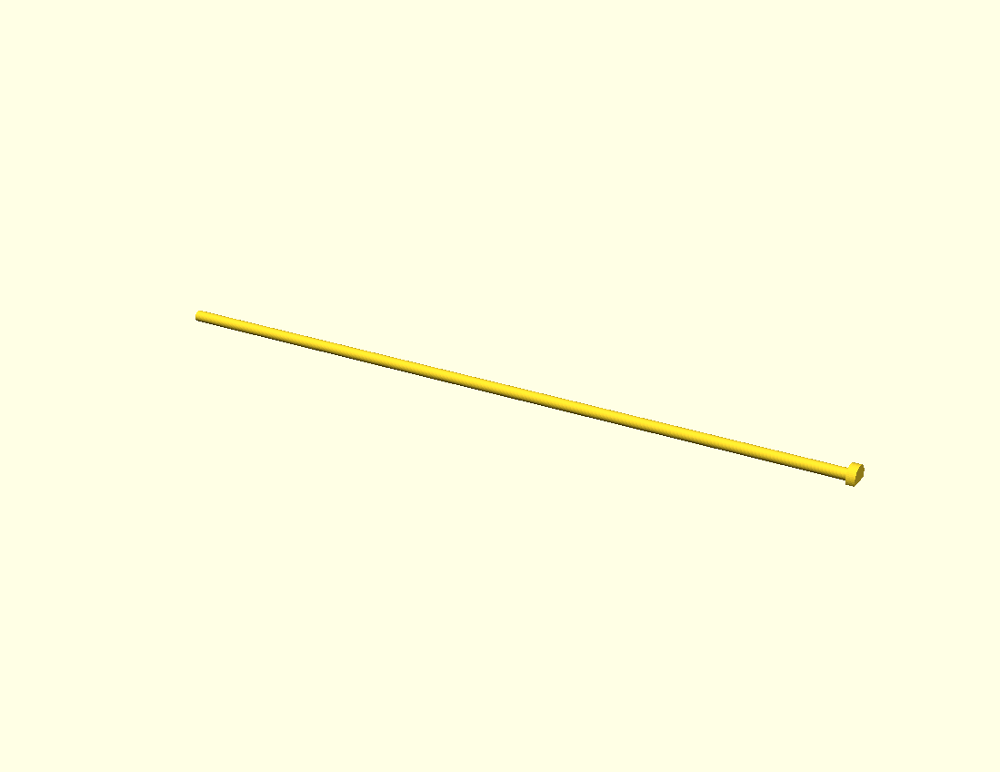
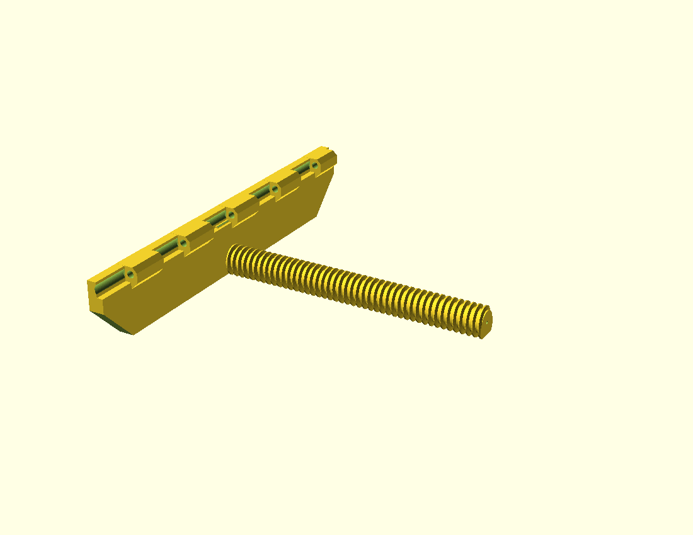
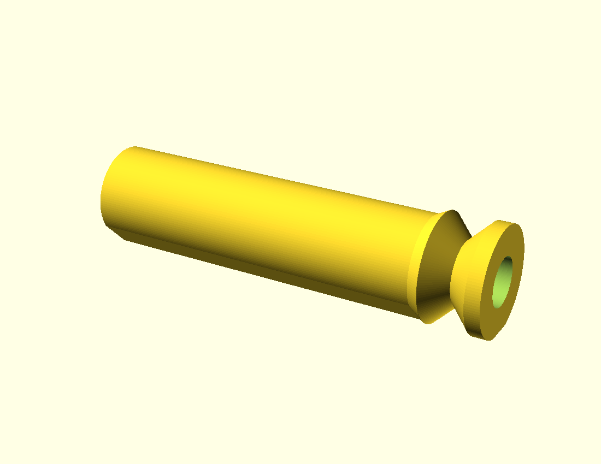
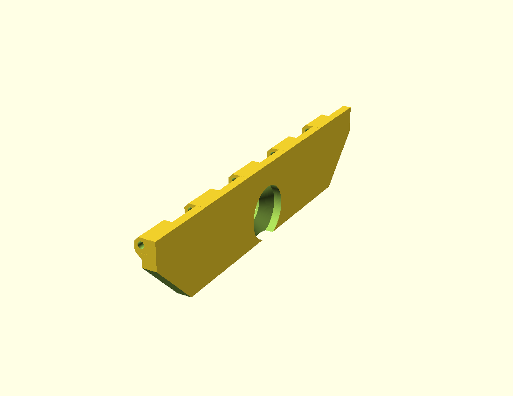
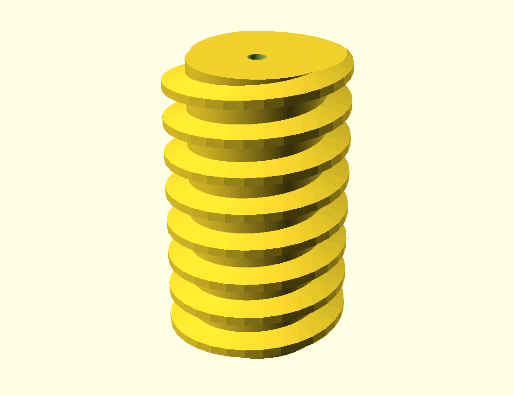
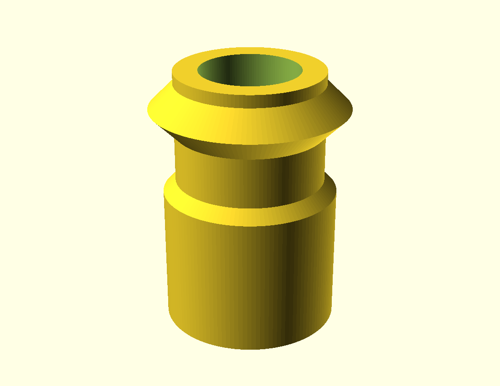
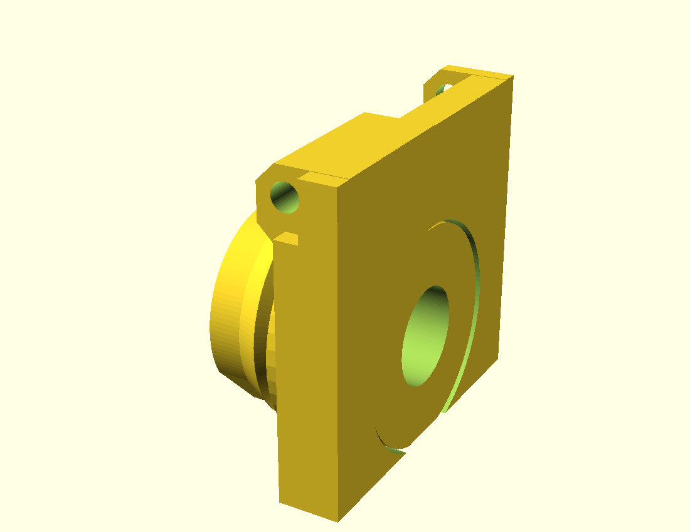
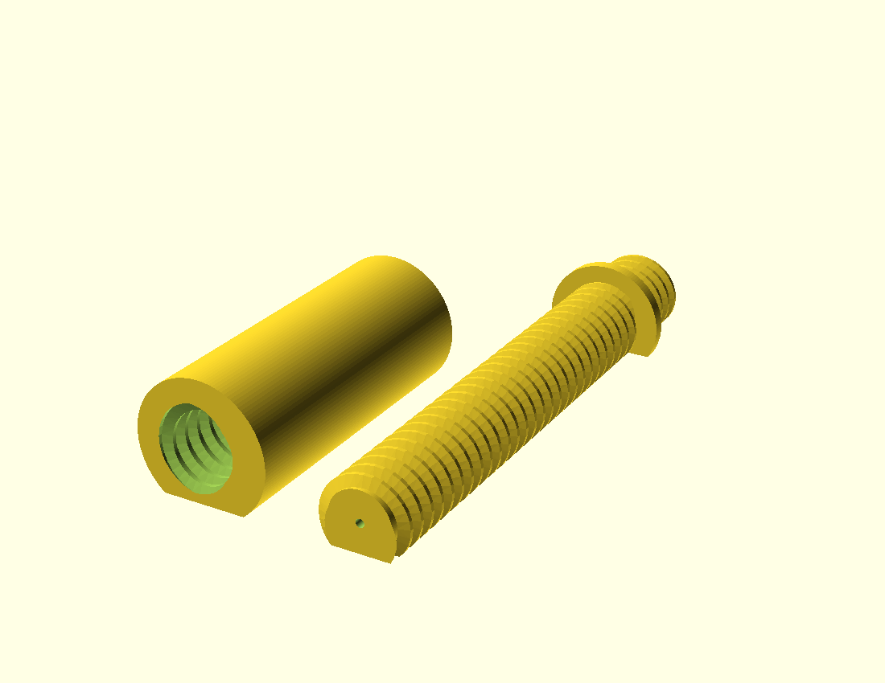

# Cửa xếp V4.2 — Danh mục chi tiết

**Cập nhật CT03/CT05:** hai sống cùng dày10 mm, đối xứng và dùng chung quy tắc vát45°. Chiều cao vát trái/phải vẫn23,7/33 mm; đáy202,6/184 mm; mép trên250 mm. Hai mặt bàn lệch9,3 mm do chân ren đực và vòng PIP cần cao độ riêng. Cắt dừng trước chân tai0,3 mm, giữ nguyên vùng tai và lỗ chốt. Khoang xoay CT05 khoét xuyên hết sống theo tham số chung `support_web_width`; vòng giữ vẫn kín.

**Gá phải CT05:** sống xuống bàn rộng 10 mm (X=0..10), đỡ toàn bộ thành X=4..10 và giữ phần nối với vòng xoay. Trục/lỗ chốt không đổi. Gờ bridge ở chân thành đã được kiểm riêng trên G-code trước/sau; bridge của mái lỗ tròn và rotor là các vùng khác.

**Cập nhật in cặp gá phải:** mở [right-pip.3mf](../exports/parts/right-pip.3mf), một đối tượng gồm hai phần `right-support` và `female-rotor`, cùng mặt cắt đáy Z=0 và giữ nguyên khe PIP. Không lấy tư thế xoay rotor trong Assembly làm hướng in. Ren đực CT03, trục CT09 và mẫu ren đực có lỗ dọc tim xuyên suốt Ø2 mm (`male_bore_d=2`), thành còn lại được kiểm >2 mm; chưa có bằng chứng lỗ rỗng làm tăng độ bền.

Dùng **mã CT và tên chi tiết** khi trao đổi hoặc yêu cầu sửa mô hình. Tên trong dấu `backtick` là selector `part` trong [accordion.scad](../accordion.scad); ren và các đường kính ren nằm trong [threads.scad](../threads.scad). Mã CT chỉ dùng trong tài liệu này, không thay selector của source.

V4.2 dùng **leaf một mảnh, một solid**: tấm phẳng và phần nối tai dày **9 mm bằng chiều cao ống bản lề**, cùng mặt đáy và cùng mặt trên. Vai nối tấm/ống là khối chữ nhật, góc **90°**, không thu nhỏ ở hai đầu. Leaf có bao danh nghĩa 51,2 × 250 × 9 mm, lỗ bản lề tròn nằm ngang Ø4,6 mm và dải tiếp xúc tai dài 24,7 mm trên mỗi nhịp 25 mm.

Cụm mặc định W=620 có 16 leaf và 17 chốt bản lề. Chỉ đổi W trong khoảng 430–1.000 mm; số leaf chẵn, số đoạn nối và chiều dài ren tự tính. Thanh đẩy tại W=620 gồm ren đực 175 mm liền gá trái và hai đoạn nối 187,5 mm in riêng. Hai gá có gân dài tới mặt bàn; vòng phải kín, min thành 2 mm; female có rãnh V lõm. Assembly và file in dùng cùng hình học đã cắt đáy. Chưa kiểm chứng tải hoặc khả năng in không support thực tế.

Ảnh chi tiết được dựng lại từ source OpenSCAD hiện tại. Ảnh có kích thước hiển thị 150 px; nhấn ảnh để mở bản lớn. Ảnh tự căn vừa khung nên không dùng để so tỷ lệ giữa các hàng. Màu chỉ giúp phân biệt mặt và khối, còn hướng in được ghi riêng trong mô tả.

## Danh mục

| Mã | Ảnh | Tên / selector | Nhận dạng, kích thước và số lượng |
| :--- | :---: | :--- | :--- |
| **CT01** |  | **Leaf một mảnh** `print-leaf` | Tấm và phần nối tai dày 9 mm bằng chiều cao ống; bao 51,2 × 250 × 9 mm, lỗ tròn ngang Ø4,6 mm, dải tai 24,7 mm. Mặt đáy tấm/ống cùng chạm bàn, mặt trên cùng cao độ. Cụm W=620 cần 16 chiếc. |
| **CT02** |  | **Chốt bản lề mặt D** `print-hinge-pin` | Thân Ø4 mm, đầu chặn Ø8 mm, tổng dài 250 mm; mặt D giữ lại với chiều cao bao khoảng 5,5 mm để đặt nằm trên bàn. Một chốt cho mỗi khe trục. Cụm W=620 cần 17 chốt. |
| **CT03** |  | **Gá trái + ren đực** `print-left-support` | Ren TR20×4 dài 175 mm tại W=620, liền gá. Gân dọc dài 250 mm tới bàn; tai chốt liền chân, biên ngoài vát. Cắt phẳng dưới ren và thêm sống nhỏ liền lõi. Bao in 185 × 250 × 42,6 mm. In 1 chiếc. |
| **CT04** |  | **Ren cái** `female` | Thân Ø32 mm dùng chung bán kính với socket CT09; chân liền rộng 9 mm chạm bàn, sườn dưới 45°, chuyển tiếp tới V dài 4 mm. Vành giữ Ø36, eo Ø21, dài tổng 139,5 mm; ren trong TR20×4 dài 118 mm và bore tròn R8,09375 giữ nguyên. Vành giữ cắt đáy 0,7 mm; thân có chân riêng theo cao độ trục 17,3 mm. In cùng CT05 bằng `print-right-pip`; hình riêng chỉ để xem. |
| **CT05** |  | **Gá phải** `right-support` | Vòng ngoài R20, kín quanh lỗ tròn; đáy còn 2,2 mm. Gân dọc dài 250 mm tới bàn. Khớp dịch vào trong để không vượt mặt ép phải. In cùng CT04 bằng `print-right-pip`, khe hướng kính 0,6 mm. Bao cụm in 140 × 250 × 51,9 mm. |
| **CT06** |  | **Mẫu thử ren đực** `print-test-male` | Đoạn ren ngoài TR20×4 dài 32 mm để thử độ ăn ren và bù FDM; không lắp trong cụm. Dùng chung `thread_offset` với source. |
| **CT07** |  | **Mẫu thử ren cái** `print-test-female` | Thân mẫu 32 mm và đuôi khớp thêm 10 mm, tổng 42 mm; đoạn ren trong dài 20 mm trước cổ trơn. Dùng thử với CT06; không lắp trong cụm. |
| **CT08** |  | **Coupon thử PIP** `print-pip-coupon` xem mặt cắt: `pip-section` | Bản rút gọn của bầu gá, khoảng rỗng và đoạn ren cái để thử chuyển động quay/khe lắp; bỏ tấm panel 250 mm và ống dài. Không thuộc bộ lắp hoàn chỉnh. |
| **CT09** |  | **Đoạn nối thanh đẩy — bộ hai chi tiết** `print-rod-extension` | Sau lắp dài tự tính 160–230 mm. Gồm socket Ø32 kín với hai đầu ren cái và trục ren đực rời có vai chặn Ø28 × 3 mm. Trục ăn ren 20 mm vào đầu sau socket; miệng trước socket sâu 25 mm giữ chức năng nối CT03/CT09 trước. Đầu làm việc dài 110 mm. Cả hai in nằm, dùng mặt cắt riêng; không mở đáy socket. Tại W=620 in 2 bộ dài 187,5 mm sau lắp. Xuất riêng bằng `print-rod-socket` và `print-rod-shaft`. |

## Kích thước và tham số chính

Đơn vị là mm. `W` là bề rộng cụm, `H` là chiều dài leaf theo source. Ảnh chi tiết được phóng riêng nên không biểu diễn tỷ lệ giữa các hàng.

| Tham số | Mặc định | Ý nghĩa |
| :--- | :---: | :--- |
| `W` | 620 | Bề rộng cấu hình cần xuất/in; source cho phép 430–1.000, gồm số lẻ/thập phân. Tự tính số leaf, số đoạn nối, vị trí hai gá và chiều dài ren. |
| `H` | 250 | Chiều dài leaf chính; source yêu cầu đúng 250 để vừa bàn in. Bộ thử rút gọn dùng leaf cao 50 mm trong `print-fit-kit`. |
| `pitch` | 42 | Khoảng cách hai trục bản lề của cùng một leaf. |
| `leaf_thickness` | 9 | Dẫn xuất từ `leaf_top - leaf_bottom`, dùng chung cho tấm và phần nối tai; bằng chiều cao ống đã vát. |
| `leaf_count` | Tự tính: 16 | `2*ceil((W-20)/(2*(pitch-2)))`; luôn chẵn để hai đầu cùng cao độ, bước chiếu ngang không quá 40 mm. Số chốt bằng `leaf_count+1`. |
| `extension_count` | Tự tính: 2 | Số đoạn nối giống nhau cần in, từ 1 đến 4 trong phạm vi W. Tại W=1.000 là 4. |
| `extension_length` | Tự tính: 187,5 | Chiều dài mỗi đoạn nối 160–230 mm, tại W=1.000 là 201,25 mm. |
| `pip_gap` | 0,6 | Khe hướng kính danh nghĩa của khớp PIP; source giới hạn 0,4–0,9. |
| `thread_offset` | -0,25 | Bù biên dạng ren cho FDM; source giới hạn -0,4 đến -0,1. |

Leaf một mảnh có panel phẳng dày 9 mm bằng chiều cao ống. Trong mô hình lắp, mặt đáy Z=-4,5 và mặt trên Z=+4,5; selector in nâng cả khối để đáy nằm tại Z=0. Các tai được tạo theo nhịp 25 mm, mỗi dải dài 24,7 mm; hai biên dùng lỗ tròn ngang bán kính 2,3 mm, tương đương Ø4,6 mm. Bao ngoài của leaf là 51,2 × 250 × 9 mm. Các con số này mô tả hình học source/mesh; chưa phải dung sai sau in.

Thành quanh lỗ chốt có gate tối thiểu **2 mm**: tai lá Ø9,2 cắt phẳng Z=±4,5 cho thành nhỏ nhất **2,2 mm**; tai hai gá có biên vát liền chân nối, thành nhỏ nhất đo được **2,084 mm**. Bộ kiểm đo lát cắt STL ở hai biên lá và cả hai gá, đồng thời xác nhận lỗ Ø4,6 giữ nguyên. Các số này mô tả CAD/STL, chưa phải kích thước hay độ bền sau in.

Mỗi phần nối từ tấm tới ống có bao 6 × 24,7 × 9 mm. Trong mặt bằng, hai cạnh đầu/cuối của phần nối vuông góc 90° với mép dài tấm. Chiều dài phần nối bằng toàn bộ dải tai 24,7 mm.

Chốt CT02 dài đúng 250 mm để vừa bàn in. Đầu Ø8 cao 3 mm nằm ở 3 mm cuối; côn chuyển tiếp 0,5 mm nằm ngay trước đầu. Mặt D là phần cắt nông của thân và đầu; kích thước bao là **250 × 8 × 5,5 mm** (dài × bao đầu × chiều cao khi đặt trên bàn). Chốt ngắn trong bộ thử có thân 51 mm và đầu 3 mm, tổng dài 54 mm.

`print-fit-kit` gồm đúng ba chi tiết rời: hai leaf một mảnh cao 50 mm và một chốt ngắn 54 mm. Cụm mặc định W=620 dùng 16 leaf và 17 chốt. Ren trái tự tính trong khoảng 175–240 mm, các đoạn nối giống nhau dài 160–230 mm. Tại W=550: ren trái 225 mm, một đoạn nối 230 mm, đầu thanh đẩy x=440. Tại W=1.000: ren trái 175 mm, bốn đoạn nối 201,25 mm, 26 leaf và 27 chốt. Mọi cấu hình giữ 25 mm chồng tại từng mối nối và 30 mm ăn ren cuối vào ống cái. Mỗi đoạn được tính pha riêng theo ren của đoạn trước; không lặp cùng góc quay cho cả chuỗi.

Đổi W là chọn cấu hình in; số lượng và chiều dài chi tiết có thể thay đổi. Số leaf luôn chẵn để hai gá cùng cao độ, W có thể là số lẻ/thập phân. Không suy ra một bộ gá đã in chỉnh được toàn dải 430–1.000 mm. Lá/chốt dài đúng 250 mm, cần kiểm vùng in thực và brim/skirt trong slicer.

## Chân nối chịu lực trên CT03 và CT05

Lực siết truyền từ trục ren ở Z=-30 qua chân nối tới sống gá và các tai bản lề. Gá và phần ren đực CT03 là một chi tiết. Clearance R4,9 theo band dành chỗ quay cho tai lá, kéo dài thêm 0,15 mm qua mặt đầu để tránh tiếp xúc đồng phẳng; không khoét band tai gá đang giữ chốt:

- Sống dọc dày 6 mm chạy đủ 250 mm theo Y, từ mặt bàn tới phần trên chân gá. Gá trái giữ thêm chân loe cục bộ rộng 64 mm.
- Mỗi mắt chốt và chân nối cùng một tiết diện polygon đùn theo band. Biên ngoài vát, lỗ trong Ø4,6 vẫn tròn; góc trên vát để tránh cấn panel khi gập.
- Tai gá có thành nhỏ nhất đo trên STL khoảng 2,084 mm. Vòng giữ rotor của CT05 kín, thành đáy 2,2 mm, không dùng rãnh hở để đặt bàn.

Trục ren, hai mặt ép ngoài, chuẩn ren và khe PIP được giữ. Khớp giữ rotor dịch vào trong 7 mm để vành cuối không vượt mặt ép phải. Các thay đổi có cắt vật liệu để đặt bàn; không áp dụng kết luận “chỉ thêm vật liệu” của bản gia cường cũ. Chưa có số đo lực chịu, mô-men siết, độ võng hay tuổi thọ sau in.

## Ren TR20×4 và khớp PIP

CT03 dùng ren ngoài TR20×4 lớp 7e; CT04 là ren trong TR20×4 lớp 7H. Ren phải, bước 4 mm, góc đỉnh 30° (mỗi sườn 15°). Source giữ đường kính catalog trong `threads.scad`; `thread_offset` chỉ tạo khoảng hở cho FDM.

| Đường kính catalog | Ren đực 7e | Ren cái 7H |
| :--- | :---: | :---: |
| Đỉnh / major | Ø19,85 | Ø20,5 |
| Trung bình / pitch | Ø17,7725 | Ø18,1775 |
| Chân đực / lỗ nhỏ cái | Ø15,287 | Ø16,1875 |

Với offset mặc định -0,25 mm, source co lõi ren đực và mở rãnh ren cái, giữ đỉnh đực Ø19,85 và lỗ nhỏ cái Ø16,1875. CT04 có rãnh V lõm ở ngoài, ren trong 118 mm và bore tròn vẫn giữ. CT09 có mối ren lắp giữa hai chi tiết, ăn ren 20 mm và vai chặn 3 mm; pha được bù để đầu làm việc 110 mm giữ nguyên hình học gốc. CT06–CT07 là mẫu ren ngắn; CT08 thử PIP mới. Mesh/STL và slicer không thay cho xác nhận ren vừa, mô-men siết, hoặc Fusion native của đúng revision.

## Selector, bộ xuất và asset chính

Mở [accordion.scad](../accordion.scad), đổi biến `part` theo bảng sau để xem hoặc xuất chi tiết. Các selector bắt đầu bằng `print-` đặt chi tiết theo hướng xuất STL. `display` và `assembly` là hai cách trình bày cùng cụm; `three-leaves` là hình minh họa ba leaf; `leaf-section` là mặt cắt ngắn.

| Mục đích | Selector | Asset |
| :--- | :--- | :--- |
| Leaf in | `print-leaf` | [parts/leaf.stl](../exports/parts/leaf.stl), [leaf.3mf](../exports/leaf.3mf), [leaf.png](../exports/leaf.png) |
| Chốt in | `print-hinge-pin` | [parts/hinge-pin.stl](../exports/parts/hinge-pin.stl), [hinge-pin.png](parts/hinge-pin.png) |
| Bộ thử lắp | `print-fit-kit` | [fit-kit.stl](../exports/fit-kit.stl), [fit-kit.png](../exports/fit-kit.png) |
| Ba leaf minh họa | `three-leaves` | [three-leaves.png](../exports/three-leaves.png) |
| Cụm trình bày | `display` / `assembly` | [assembly.png](../exports/assembly.png), [accordion.stl](../exports/accordion.stl) |
| Mặt cắt leaf | `leaf-section` | [leaf-section.png](../exports/leaf-section.png) |
| Gá trái + ren đực | `print-left-support` | [left-support.stl](../exports/parts/left-support.stl), [left-support.png](parts/left-support.png) |
| Ren cái | `female` | [female.png](parts/female.png) |
| Gá phải riêng — hình học tham chiếu | `right-support` | [right-support.stl](../exports/parts/right-support.stl), [right-support.png](parts/right-support.png) |
| Bộ gá phải + ống cái để in PIP | `print-right-pip` | [right-pip.stl](../exports/parts/right-pip.stl) — hai khối giữ đúng vị trí tương đối |
| Đoạn nối thanh đẩy | `print-rod-extension` | [rod-extension.png](parts/rod-extension.png) |
| Thân socket của CT09 | `print-rod-socket` | [rod-socket.stl](../exports/parts/rod-socket.stl), [rod-socket.png](parts/rod-socket.png) |
| Trục ren đực của CT09 | `print-rod-shaft` | [rod-shaft.stl](../exports/parts/rod-shaft.stl), [rod-shaft.png](parts/rod-shaft.png) |
| CT09 sau lắp | `rod-extension` | [rod-extension-assembled.png](parts/rod-extension-assembled.png) |
| Mẫu ren đực | `print-test-male` | [test-male.png](parts/test-male.png) |
| Mẫu ren cái | `print-test-female` | [test-female.png](parts/test-female.png) |
| Coupon PIP | `print-pip-coupon` | [pip-coupon.png](parts/pip-coupon.png) |

Các selector kiểm tra như `joint-collision`, `hardware-collision`, `thread-collision`, `pip-rotation-check`, `pip-pull-left` và `pip-pull-right` là probe hình học, không phải chi tiết trong catalog để in.

Báo cáo [validation summary](VALIDATION.md) gắn SHA-256 với source, STL và profile. Quy trình kiểm giao khớp/ren tại 16 cấu hình W=430–1.000 mm; trên cùng bộ W=620 kiểm 17 tư thế siết từ 0 đến 75 mm, giữ nguyên các chi tiết in. Khớp PIP được quét 72 góc cách nhau 5° tại W=620, thêm tám góc tại W=430/550/1.000 và probe kéo ±1,2 mm. Có đối chứng cố ý sai pha ren và ép quá vai chặn CT09.

Tại W=620, CT09 in thành hai mesh kín: socket 32 × 74,5 × 28,5 mm và trục 28 × 133 × 21 mm, cùng đáy Z=0; file cả bộ chiếm 68 × 133 mm. Sau lắp dài 187,5 mm. Cụm mặc định có 40 chi tiết in thực. `exports/accordion.stl` được xuất từng chi tiết rồi ghép nên giữ 40 component; `exports/accordion.3mf` giữ 40 object riêng. Xuất Boolean trực tiếp selector `display` vẫn có thể hợp nhất mặt vai/socket thành 38 component; đó không phải inventory file in. Cấu hình W=1.000 có 60 component sau hợp nhất tương tự. Đây là kiểm tra hình học offline, chưa phải thử tải hay in thật.

## Trạng thái kiểm chứng

- Với profile chẩn đoán trên PrusaSlicer 2.9.6, tự tạo support ở ngưỡng 45° cho full leaf đề xuất lượng nhựa support tương đương khoảng **2 607 mm³ (2,61 cm³)**. Mái tròn của các tai tạo các đoạn cần bridge; vì vậy báo cáo giữ phần chẩn đoán tự tạo support riêng.
- Khi tắt support bằng cấu hình xuất toolpath, support extrusion ghi nhận **0 mm³** và chuyển động đùn dài nhất ở role bridge là **5,161 mm tại Z=7,0 mm**, đã tính cả anchor. Chỉ số này mô tả toolpath bridge, không đo span không đỡ hoặc độ võng vật lý.
- Việc tắt support là một cấu hình của toolpath, **không phải bằng chứng in không support ngoài thực tế**. Không suy diễn từ con số 0 này rằng mái tròn chắc chắn in được trên mọi máy, vật liệu hoặc profile.
- Đã chạy cắt lớp tắt support cho các chi tiết in; đường đùn được kiểm trong bàn 250 × 250 mm. Gá phải/PIP vẫn có cảnh báo bridge và bám bàn, nên chưa xác nhận in không support thực tế. CT09 tách mới có chẩn đoán riêng trong audit; không suy kết quả của một chi tiết cho toàn bộ cụm.
- Chưa xác minh bằng in thật: độ bám bàn, cong vênh, độ vừa Ø4,6 mm và mặt D, độ trượt/lắp của các leaf, lực và độ bền bản lề, tải/mỏi/creep, độ kín cửa, độ vừa ren/PIP sau in.
- Script Fusion native nằm ở [fusion/README.md](../fusion/README.md). Bộ V4.2 bàn giao cùng input cố định trước thay đổi female32; evidence W620 ghi40 solid instance và6 modeled Thread definitions. [Tóm tắt kiểm chứng](VALIDATION.md) phân biệt baseline Fusion này với source final hiện hành. Đồng bộ native theo final và thử in/lắp/tải vật lý giữ trạng thái `not_run`.

Tham khảo: [Prusa — thiết kế cho in 3D](https://help.prusa3d.com/article/modeling-with-3d-printing-in-mind_164135); [PrusaSlicer 2.9.6](https://github.com/prusa3d/PrusaSlicer/releases/tag/version_2.9.6).
